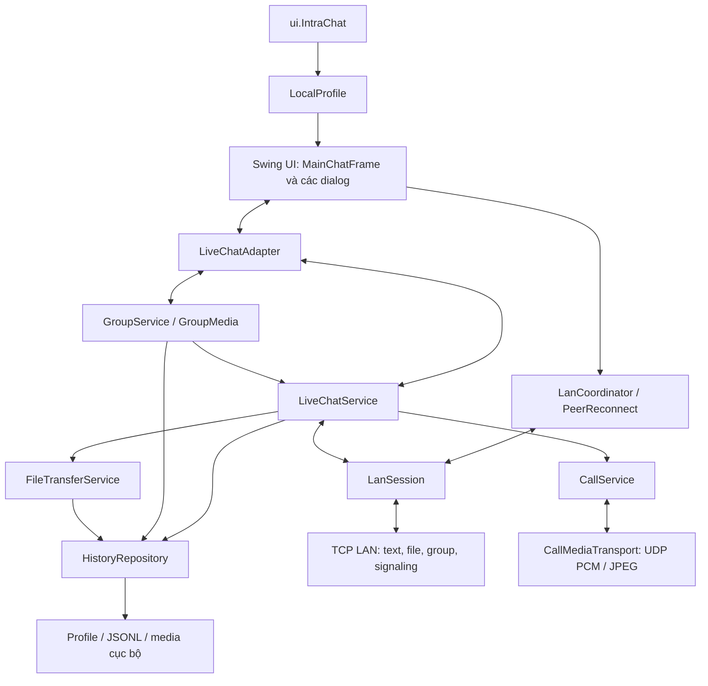
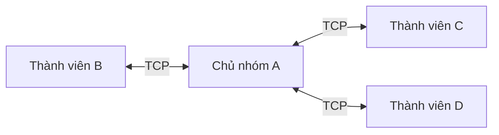

# IntraChat — Ứng dụng nhắn tin trong mạng LAN

IntraChat là ứng dụng desktop Java cho phép các thiết bị trong mạng nội bộ trao đổi tin nhắn, hình ảnh, video, âm thanh, tệp và thực hiện cuộc gọi P2P mà không cần máy chủ trung tâm. Giao diện Swing + FlatLaf lấy cảm hứng từ Messenger; lịch sử và media được lưu cục bộ theo từng hồ sơ người dùng.

> **Lưu ý:** TCP, UDP media cuộc gọi và dữ liệu lưu trên đĩa chưa được mã hóa. UUID/tên thiết bị là danh tính tự khai, không phải cơ chế xác thực. Chỉ sử dụng trên LAN tin cậy, không mở cổng ra Internet và không truyền dữ liệu nhạy cảm.

## Mục lục

- [Kiến trúc dự án](#1-kiến-trúc-dự-án)
- [Các chức năng](#2-các-chức-năng)
- [Yêu cầu và cách chạy](#3-yêu-cầu-và-cách-chạy)
- [Hướng dẫn sử dụng](#4-hướng-dẫn-sử-dụng)
- [Lưu trữ dữ liệu](#5-lưu-trữ-dữ-liệu)
- [Hạn chế](#6-hạn-chế)
- [Xử lý sự cố](#7-xử-lý-sự-cố)
- [Kiểm thử và tài liệu](#8-kiểm-thử-và-tài-liệu)

## 1. Kiến trúc dự án

### 1.1. Công nghệ

| Thành phần | Công nghệ |
|---|---|
| Ngôn ngữ | Java 21 |
| Giao diện | Java Swing, FlatLaf |
| Build | Maven Wrapper, Maven Shade Plugin |
| Chat, truyền tệp và signaling cuộc gọi | TCP socket, JSON/UTF-8 (Jackson), frame có tiền tố độ dài |
| Media cuộc gọi thời gian thực | UDP, PCM audio và JPEG video phân mảnh |
| Âm thanh | Java Sound |
| Webcam / chia sẻ màn hình | videoInput/JavaCPP Windows x64, AWT Robot |
| Lưu trữ | JSON/JSONL và tệp cục bộ |
| Kiểm thử | JUnit 5, process smoke và Swing GUI smoke |

### 1.2. Kiến trúc phần mềm



Sơ đồ biểu diễn luồng chức năng, không phải sơ đồ dependency tuyệt đối. UI nhận cập nhật qua adapter; các tác vụ mạng, truyền tệp và ghi lịch sử sử dụng worker. TCP là transport chung cho chat, nhóm, truyền media dưới dạng tệp và signaling cuộc gọi; UDP dành riêng cho media cuộc gọi thời gian thực.

**P2P trực tiếp:** Hai thiết bị kết nối TCP bằng IPv4 và cổng Listen. Thiết bị nhận chấp nhận yêu cầu lần đầu. Không cần server trung tâm.

**Nhóm (Owner Relay):** Chủ nhóm quản lý roster và chuyển tiếp tin nhắn/media giữa các thành viên. Thành viên gửi qua chủ nhóm; không bắt buộc thiết lập P2P giữa mọi thành viên. Media nhóm được chuyển tiếp sau khi chủ nhóm kiểm tra kích thước và CRC32.



**Cuộc gọi P2P:** TCP trao đổi yêu cầu gọi, chấp nhận/từ chối, cổng UDP, trạng thái và kết thúc cuộc gọi. UDP vận chuyển âm thanh PCM 16 kHz mono 16-bit và hình ảnh JPEG. Cuộc gọi không được relay qua nhóm.

### 1.3. Cấu trúc thư mục

```text
IntraChat/
├── pom.xml                     # Cấu hình Maven và dependencies
├── mvnw.cmd / .mvn/             # Maven Wrapper
├── run.cmd / run.ps1           # Launcher Windows
├── src/
│   ├── main/java/
│   │   ├── ui/
│   │   │   ├── IntraChat.java    # Entry point
│   │   │   ├── frames/          # MainChatFrame
│   │   │   ├── dialogs/         # LAN, nhóm, thành viên, cuộc gọi
│   │   │   └── components/      # Avatar, bubble, composer, media
│   │   ├── listener/            # Adapter và callback UI
│   │   ├── model/               # Model hiển thị hội thoại/tin nhắn
│   │   └── vn/intrachat/
│   │       ├── application/     # Service nghiệp vụ, kết nối, gọi P2P
│   │       ├── domain/          # Định danh và mô hình nghiệp vụ
│   │       ├── protocol/        # FrameCodec, WireCodec, WireMessage
│   │       ├── transport/       # TCP session, UDP media, IPv4
│   │       └── persistence/     # HistoryRepository
│   └── test/java/              # JUnit tests
├── scripts/                    # Kiểm chứng backend và GUI
├── docs/                       # Kiến trúc, ma trận, báo cáo kiểm chứng
├── data/                       # Profile và dữ liệu runtime (Git ignore)
└── target/                     # Build output (Git ignore)
```

## 2. Các chức năng

### 2.1. Chức năng MVP

| ID | Chức năng | Mô tả |
|---|---|---|
| F01 | Chat riêng | Gửi/nhận văn bản trực tiếp qua TCP |
| F02 | Chat nhóm | Tạo nhóm, mời thành viên, owner relay, quản lý danh sách và rời nhóm |
| F03 | Truyền tệp | Gửi tệp riêng/nhóm, tiến trình, hủy và kiểm tra toàn vẹn |
| F04 | Emoji | Gửi emoji Unicode cùng nội dung tin nhắn |
| F05 | Lịch sử | Lưu và khôi phục hội thoại, nhóm, metadata media và endpoint |
| F06 | Hình ảnh | Gửi PNG/JPEG, thumbnail và xem trước |
| F07 | Video | Gửi MP4/AVI/MKV, mở bằng trình phát mặc định |
| F08 | Âm thanh | Gửi WAV/MP3/M4A, ghi âm WAV, phát WAV PCM |
| F09 | Trạng thái | SENT, DELIVERED (ACK), SEEN (READ); kết quả media theo thành viên |
| F10 | Thời gian | Timestamp UTC trong giao thức, hiển thị giờ tin nhắn |
| F11 | Người gửi | UUID, tên và avatar; giữ origin khi relay nhóm |

### 2.2. Tính năng mở rộng và trải nghiệm

- **Gọi thoại/video P2P:** chấp nhận hoặc từ chối cuộc gọi, mute, bật/tắt camera, chia sẻ màn hình và kết thúc. Chỉ gọi cá nhân online, một cuộc gọi tại một thời điểm.
- **Tự kết nối:** nhận diện IPv4 LAN riêng, tự Listen và lưu cổng thành công; profile cũ mở thẳng Messenger, hiển thị history offline và thử lại endpoint đã biết.
- **Đồng bộ nhóm:** sau reconnect, thành viên đồng bộ roster với chủ nhóm trước khi gửi tin/media.
- **Nhận media tự động:** lưu tệp vào thư mục media của người nhận, không hỏi vị trí và không tự thực thi tệp. Tệp P2P trùng tên có hậu tố số; nhóm dùng thư mục con riêng.
- **Giao diện Messenger:** sidebar tìm kiếm, avatar, composer media, một nút micro và nút nốt nhạc riêng. Bánh răng cuối bên phải Profile mở Cài đặt LAN; nút Nhóm chỉ xuất hiện khi chọn hội thoại nhóm.
- **Quản lý thành viên:** danh sách có avatar, tên, vai trò chủ nhóm và trạng thái liên kết trực tiếp. Chủ nhóm có thể loại thành viên bằng tên; thành viên thường có nút Rời nhóm khi chủ nhóm sẵn sàng. Các thao tác đều có xác nhận.

## 3. Yêu cầu và cách chạy

### 3.1. Môi trường

- Windows x64 có desktop (đặc biệt cho webcam dùng native Windows).
- JDK **21** gồm cả `java` và `javac`.
- Git nếu clone từ GitHub; không cần cài Maven riêng.
- Internet khi tải dependencies/build lần đầu; chat sau khi build chỉ cần kết nối LAN.
- Microphone, loa/tai nghe, webcam và quyền truy cập thiết bị nếu dùng cuộc gọi hoặc ghi âm.

### 3.2. Clone và chạy nhanh

Mở PowerShell:

```powershell
git clone https://github.com/ChienPM-27/IntraChat.git
cd IntraChat
.\run.cmd
```

Launcher tự tìm JDK 21 từ JAVA_HOME, JDK portable, PATH hoặc các thư mục JDK trong Program Files; sau đó build bằng Maven Wrapper (bao gồm JUnit mặc định) và mở ứng dụng. Có thể double-click `run.cmd`.

| Lệnh | Mục đích |
|---|---|
| `.\run.cmd -JavaHome 'C:\Path\To\jdk-21'` | Chỉ định JDK 21 |
| `.\run.cmd -SkipBuild` | Chạy JAR đã build, không chạy lại test |
| `.\run.cmd -User Alice` | Chọn hồ sơ Alice |
| `.\run.cmd -DataDir 'C:\Temp\IntraChat-A'` | Tách thư mục dữ liệu |
| `.\run.cmd -Diagnostics` | Build và kiểm tra thông tin ứng dụng, không mở GUI |
| `.\run.cmd -SkipBuild -Diagnostics` | Diagnostics của JAR có sẵn, không build/test |

Chỉ dùng `-SkipBuild` nếu JAR đã được build từ phiên bản mong muốn.

### 3.3. Build thủ công

```powershell
$env:JAVA_HOME = 'C:\Path\To\jdk-21'
$env:Path = "$env:JAVA_HOME\bin;$env:Path"
.\mvnw.cmd clean package
java -jar target\intrachat-0.1.0-SNAPSHOT.jar
```

Nếu chỉ muốn build mà không chạy JUnit:

```powershell
.\mvnw.cmd clean package "-DskipTests"
java -jar target\intrachat-0.1.0-SNAPSHOT.jar
```

Entry point: `ui.IntraChat`. JAR đã đóng gói dependencies. Đóng ứng dụng đang chạy trước khi build lại để tránh Windows khóa JAR.

## 4. Hướng dẫn sử dụng

### 4.1. Kết nối hai máy trong LAN

1. Cập nhật cùng phiên bản IntraChat trên cả hai máy, kết nối cùng Wi-Fi/LAN hoặc mạng có route phù hợp.
2. Mở app và chọn tên hồ sơ lần đầu. Ứng dụng tự lắng nghe tại IPv4 LAN của máy, mặc định cổng **47321**.
3. Trên máy A, xem mục **Thiết bị của bạn** trong Cài đặt LAN. Nếu IP không đúng, nhấn **Dừng**, chọn IPv4 phù hợp và **Bắt đầu**. Có thể kiểm tra bằng `ipconfig`.
4. Trên máy B, nhập IPv4 và cổng của A ở mục **Kết nối thiết bị khác**, nhấn **Kết nối**.
5. Trên máy A, kiểm tra yêu cầu và nhấn **Chấp nhận**. Sau khi kết nối, gửi tin nhắn từ giao diện Messenger.

Không dùng `127.0.0.1` để kết nối hai máy khác nhau. Nếu firewall chặn, cho phép Java/IntraChat trên mạng Private; chat cần TCP tới cổng Listen, cuộc gọi cần thêm UDP cổng động. Không vô hiệu hóa toàn bộ firewall hoặc mở cổng Internet.

### 4.2. Chạy thử hai người dùng trên cùng máy

Build một lần, sau đó mở hai cửa sổ PowerShell ở root dự án:

```powershell
# Cửa sổ A
.\run.cmd -SkipBuild -User Alice
```

```powershell
# Cửa sổ B
.\run.cmd -SkipBuild -User Bob
```

Trong Cài đặt LAN, chọn IPv4 `127.0.0.1` ở cả hai bên. A Listen cổng `47321`, B Listen cổng `47322` (dừng trước khi đổi cổng); B kết nối tới `127.0.0.1:47321`, A chấp nhận. Mỗi tiến trình phải dùng hồ sơ/dataDir riêng. Có thể mở C với `-User Charlie` và cổng `47323` để thử nhóm.

### 4.3. Chat, nhóm và media

- Chọn hội thoại cá nhân để gửi văn bản/emoji. Nút **+** ở đầu sidebar tạo nhóm; chọn các peer đang kết nối và chờ họ chấp nhận lời mời.
- Trong chat nhóm, nhấn **Nhóm** để xem thành viên và thực hiện thao tác theo quyền. Trạng thái trong danh sách chỉ biểu thị kết nối trực tiếp với máy đang xem, không phải trạng thái online toàn nhóm.
- Dùng các icon ảnh, video, tệp, nốt nhạc hoặc micro trên composer. Media chỉ gửi được khi tuyến P2P hoặc nhóm sẵn sàng.
- Tệp nhận được tự lưu; dùng thumbnail, điều khiển WAV hoặc nút mở tệp/vị trí. Video và MP3/M4A phụ thuộc ứng dụng phát của hệ điều hành.
- Trong chat riêng online, nhấn icon điện thoại/video để gọi. Người nhận cần chấp nhận; sử dụng điều khiển mute, camera, chia sẻ màn hình hoặc kết thúc trong cửa sổ cuộc gọi.

### 4.4. Khởi động lại

Profile đã tồn tại mở trực tiếp Messenger kể cả khi chưa có peer online. Ứng dụng khôi phục history và Listen, thử kết nối lại endpoint private/loopback đã lưu khoảng mỗi 15 giây. Peer mới phải chấp nhận thủ công; peer cũ chỉ được tự chấp nhận nếu UUID và IP đã ghi nhận khớp.

- Lịch sử cũ chưa lưu IP/cổng hoặc thiết bị đổi IP/cổng: mở bánh răng Settings và kết nối thủ công một lần để cập nhật.
- Nhấn **Ngắt kết nối** để tạm dừng auto reconnect trong phiên; nhấn **Kết nối** để tiếp tục.
- Tự reconnect không tự gửi lại tin hoặc tiếp tục truyền tệp dang dở.

## 5. Lưu trữ dữ liệu

```text
data/
├── last-user.txt
└── Alice/
    ├── profile.json
    ├── history/
    └── media/
        ├── example.png
        └── <groupId>/<transferId>/...
```

`LocalProfile` lưu UUID và tên người dùng; `HistoryRepository` lưu JSONL gồm hội thoại, nội dung, trạng thái, thời gian, metadata nhóm/file và endpoint. Tên thư mục được chuẩn hóa theo quy tắc tên tệp Windows.

Dùng lại cùng `-User` hoặc `-DataDir` để khôi phục lịch sử; không dùng chung một thư mục cho nhiều tiến trình. `-DataDir` ghi đè đường dẫn lưu mặc định. Dữ liệu chỉ tồn tại cục bộ, không có cloud sync. Media đã lưu phải còn ở đường dẫn thực tế mới mở lại được. Thư mục `data/` và `target/` không được commit.

## 6. Hạn chế

| Hạng mục | Giới hạn hiện tại |
|---|---|
| Kết nối | IPv4 literal; tối đa 4 TCP session hoạt động, 4 yêu cầu phê duyệt chờ |
| Nhóm | Tối đa 5 thành viên; cần chủ nhóm online/đồng bộ; không tự chuyển chủ |
| Reconnect | Tối đa 32 endpoint đã nhớ; không dò IP mới hoặc scan LAN |
| Tệp/video | Tối đa 128 MiB |
| Ảnh | PNG/JPEG, tối đa 16 MiB và 32 MP |
| Âm thanh | WAV/MP3/M4A, tối đa 8 MiB; ghi âm tối đa 120 giây |
| Truyền media | Chunk 32 KiB, 1 transfer/peer; tối đa 16 job media nhóm active, timeout tổng 10 phút |
| Cuộc gọi | Một cuộc gọi P2P tại một thời điểm, không gọi nhóm; timeout đổ chuông 45 giây |
| Lịch sử | Tối đa 10.000 message entries trong index RAM, 500/view; không cloud sync |
| Bảo mật | TCP/UDP/JSONL plaintext; không xác thực mật mã, không mã hóa đầu cuối |

Không có offline delivery queue, resume truyền tệp hoặc tự resend khi reconnect. Hủy truyền tệp là best-effort, không thu hồi bản sao đã nhận. DELIVERED là ACK phía nhận, không đảm bảo fsync; SEEN biểu thị tin đã hiển thị theo điều kiện UI, không chứng minh người dùng đã đọc bằng mắt. CRC32 kiểm tra lỗi dữ liệu, không cung cấp xác thực mật mã. Webcam/codec và audio phụ thuộc thiết bị, quyền truy cập và hệ điều hành.

## 7. Xử lý sự cố

| Hiện tượng | Cách xử lý |
|---|---|
| Không tìm thấy JDK 21 | Cài JDK 21 hoặc truyền `-JavaHome` tới đúng thư mục JDK |
| Maven không xóa được JAR | Đóng IntraChat đang chạy rồi build lại; không xóa profile |
| Không kết nối được | Kiểm tra IPv4 bằng `ipconfig`, cổng Listen, firewall Private và cùng phiên bản |
| Port bị chiếm | Dừng lắng nghe, chọn cổng khác rồi Bắt đầu |
| Không tự reconnect | Kiểm tra endpoint cũ; dùng Settings kết nối thủ công khi IP/cổng đổi |
| Không gửi được media nhóm | Kiểm tra chủ nhóm, roster, peer offline/bận và giới hạn tệp |
| Không phát được video/âm thanh | Kiểm tra tệp còn tồn tại, ứng dụng mặc định, codec và thiết bị |
| Không gọi được | Kiểm tra chat riêng online, quyền microphone/camera, firewall UDP và cuộc gọi đang hoạt động |

## 8. Kiểm thử và tài liệu

### 8.1. Kết quả đã ghi nhận

Bằng chứng trước lần viết lại README (28/11/2026):

| Kiểm chứng | Kết quả |
|---|---|
| JUnit Java 21 | 113/113 PASS |
| Backend P1–P5 | PASS trên bản hợp nhất P2P Call |
| GUI auto reconnect hai JVM | PASS trên bản hợp nhất P2P Call |
| GUI media và group members | PASS smoke localhost, kiểm tra vai trò và hủy xác nhận |
| GUI Cài đặt LAN | PASS smoke localhost: Listen, Stop, Accept, Settings, Disconnect |
| P2P Call signaling / UDP | PASS test không dùng phần cứng |
| LAN vật lý, cuộc gọi GUI thực, webcam/microphone/screen capture và playback | Chưa nghiệm thu |
| Xác nhận loại/rời nhóm trên GUI mới, stress disk full/ACL/crash | Chưa nghiệm thu |

Kết quả trên là bằng chứng đã có, **không phải kết quả chạy lại test khi cập nhật README**. Backend và GUI localhost không đồng nghĩa nghiệm thu đầy đủ trên thiết bị thực.

### 8.2. Lệnh kiểm chứng tham khảo

Chỉ chạy khi cần kiểm thử; các lệnh GUI yêu cầu desktop và JAR đã build. Đặt JAVA_HOME/PATH trỏ JDK 21 trước khi chạy.

```powershell
.\mvnw.cmd clean test package
powershell.exe -NoProfile -ExecutionPolicy Bypass -File .\scripts\verify-all.ps1 -JavaHome 'C:\Path\To\jdk-21'
powershell.exe -NoProfile -ExecutionPolicy Bypass -File .\scripts\verify-reconnect-gui.ps1 -JavaHome 'C:\Path\To\jdk-21'
java -cp target\intrachat-0.1.0-SNAPSHOT.jar scripts\MediaGuiSmoke.java "$env:TEMP\IntraChat-MediaGui-$([guid]::NewGuid().ToString('N'))"
java -cp target\intrachat-0.1.0-SNAPSHOT.jar scripts\LanSettingsGuiSmoke.java "$env:TEMP\IntraChat-LanGui-$([guid]::NewGuid().ToString('N'))"
```

### 8.3. Tài liệu chi tiết

| Tài liệu | Nội dung |
|---|---|
| [DESIGN.md](DESIGN.md) | Thiết kế giao diện |
| [ROADMAP.md](ROADMAP.md) | Tiến độ và phạm vi |
| [docs/architecture.md](docs/architecture.md) | Kiến trúc và giao thức |
| [docs/feature-matrix.md](docs/feature-matrix.md) | Ma trận chức năng |
| [docs/current-verification.md](docs/current-verification.md) | Bằng chứng kiểm chứng bản hợp nhất |
| [docs/p6-final-report.md](docs/p6-final-report.md) | Báo cáo P6 và lịch sử cleanup |
| [AGENTS.md](AGENTS.md) | Quy tắc phát triển và bảo trì |
